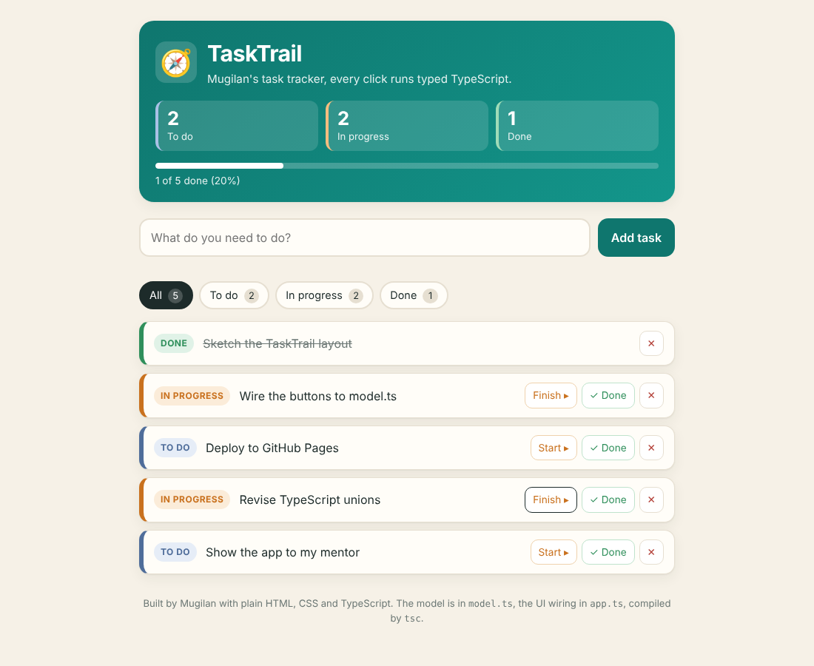
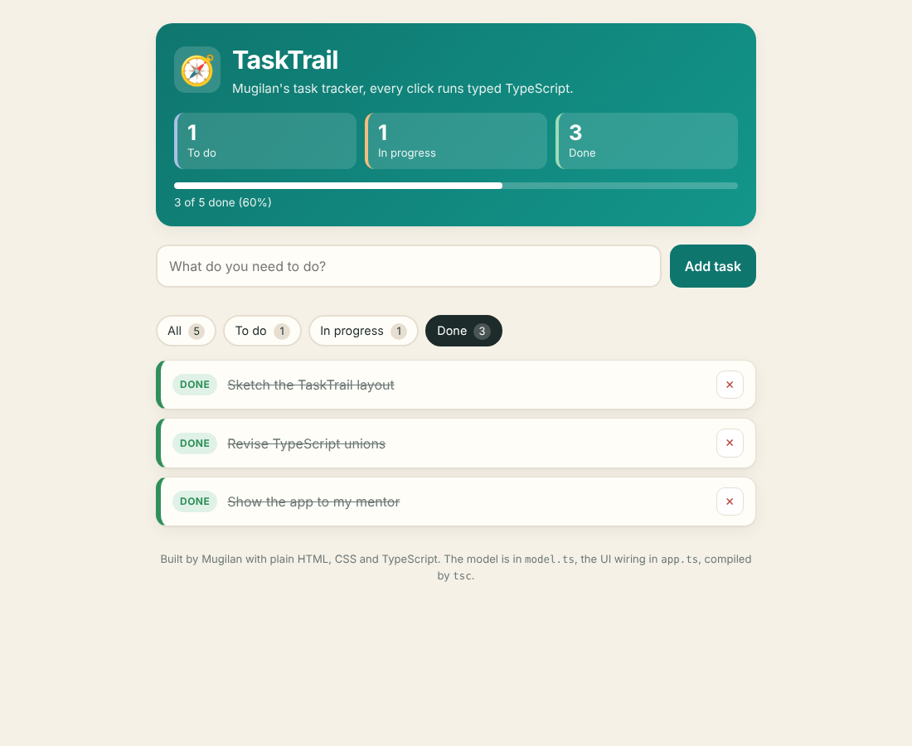
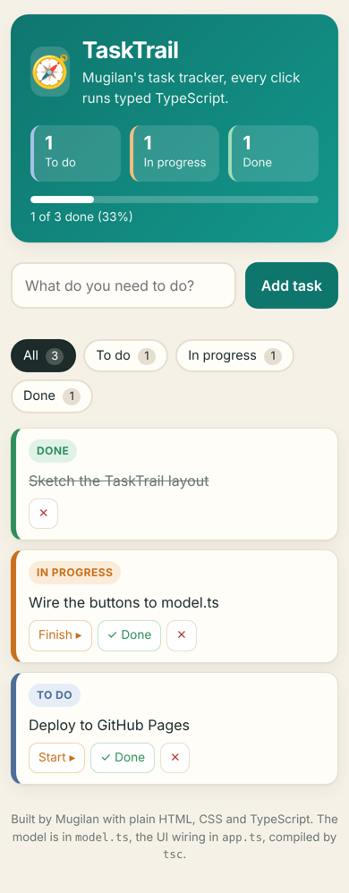

# TypeTasks → TaskTrail

A small, type-safe task tracker built with TypeScript. Part 2 turns the typed model into **TaskTrail**,
a real app with a plain HTML/CSS interface.

- **Live app:** https://mugilstrange-ai.github.io/typetasks/
- **Repo:** https://github.com/mugilstrange-ai/typetasks

## Part 1: the typed model

Everything lives in [`model.ts`](./model.ts):

| What | Type |
| --- | --- |
| `TaskStatus` | `"todo" \| "in-progress" \| "done"` (only these three values are allowed) |
| `Task` | `{ id: number; title: string; status: TaskStatus }` |
| `addTask(tasks, title)` | adds a new `"todo"` task with the next unique id |
| `completeTask(tasks, id)` | marks that task `"done"` |
| `filterByStatus(tasks, status)` | keeps only tasks with that status |

My own extra operations:

| What | Does |
| --- | --- |
| `advanceTask(tasks, id)` | moves a task one step: `todo → in-progress → done` |
| `renameTask(tasks, id, title)` | changes a task's title |
| `deleteTask(tasks, id)` | removes a task |
| `countByStatus(tasks)` | returns counts for every status, e.g. `{ todo: 2, "in-progress": 1, done: 3 }` |

Every operation returns a **new** array and never changes the one it was given.

### Proof the types are tight

These were tried and each one fails to compile (see the comments at the bottom of `model.ts`):

- a `Task` with no `status` → *Property 'status' is missing*
- `id: "3"` → *Type 'string' is not assignable to type 'number'*
- `filterByStatus(tasks, "finished")` → *not assignable to parameter of type 'TaskStatus'*

## Part 2: the UI, wired to the typed model

| File | What it does |
| --- | --- |
| [`index.html`](./index.html) | task input, **Add task** button, task list (`<ul>`), filter chips for `all` / `todo` / `in-progress` / `done`, live counts and a progress bar. Loads `<script type="module" src="app.js">`. |
| [`style.css`](./style.css) | my own design: teal header, one colour per status, pill filter chips, cards that stack on phones |
| [`app.ts`](./app.ts) | imports the Part 1 model and connects it to the page |
| `model.js`, `app.js` | what `tsc` compiles from the `.ts` files; committed so GitHub Pages can serve them |

Every click runs a typed operation from `model.ts`, then the list is re-rendered:

| On the page | Calls |
| --- | --- |
| **Add task** | `addTask(tasks, title)` |
| **Start ▸ / Finish ▸** | `advanceTask(tasks, id)`: `todo → in-progress → done` |
| **✓ Done** | `completeTask(tasks, id)` |
| **✕** | `deleteTask(tasks, id)` |
| Filter chips | `filterByStatus(tasks, status)` with `status: TaskStatus` |
| Header counts, chip counts, progress bar | `countByStatus(tasks)` |

No `any` anywhere: elements are fetched with typed casts such as
`document.getElementById("title") as HTMLInputElement`, and anything from outside (the `data-*`
attributes on buttons and the JSON saved in `localStorage`) goes through a type guard
(`isFilter`, `isAction`, `isTask`) before it is used. A `never` check in the button handler makes `tsc`
fail if a new action is ever added without being handled.

### Screenshots

| Advancing a task (badge changes to In progress) | Filtered to Done | Phone |
| --- | --- | --- |
|  |  |  |

## Build and run

```bash
npm install
npx tsc                  # compiles model.ts and app.ts to model.js and app.js, zero errors
python3 -m http.server   # or any static server, then open http://localhost:8000
```

The [Type-check workflow](.github/workflows/typecheck.yml) runs `tsc` on every pull request, checks
that the committed `.js` files match the compiler output and that no `any` is used.

## Deployment

GitHub Pages serves the repo as a static site: https://mugilstrange-ai.github.io/typetasks/
